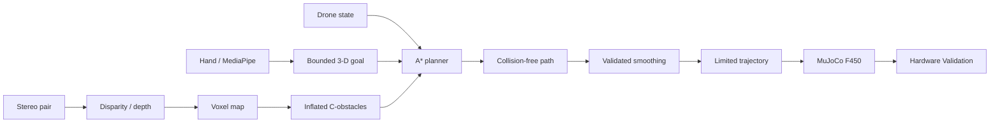

# ECE 3162: Hand-Tracking F450 Quadcopter with Stereo-Vision Motion Planning and Autonomous CAS

## Project Overview

This platform lets a person choose a 3-D goal with hand motion while a
planner decides how an F450-style quadcopter can reach it safely. MediaPipe is
the human interface, stereo is the environment sensor, MuJoCo is the primary
interactive simulator, and PX4 will later retain low-level flight control. The
hand never commands motors, rotor speed, thrust, or attitude directly.

## Motion-Planning Objective

The focus is configuration-space modeling, occupancy mapping, collision
checking, planning, smoothing, time-parameterized trajectories, and replanning.
The initial configuration is `q = [x, y, z]`.

## System Architecture



Frames are explicit. OpenCV camera is +x right, +y down, +z forward; body FLU
is +x forward, +y left, +z up; planning uses local ENU; the future PX4 boundary
converts explicitly to NED.

## Repository Structure

```text
config/             YAML settings
scripts/            executable tools and simulations
simulation/models/  MuJoCo F450 MJCF
simulation/worlds/  planner YAML and MuJoCo worlds
src/common/         frame-aware shared messages
src/mapping/        voxel maps, transforms, inflation
src/planning/       A*, collision checking, smoothing
src/trajectory/     time parameterization
src/hand_tracking/  MediaPipe tracking and goal generation
src/stereo/         stereo perception pipeline
tests/              hardware-free tests
```

## Installation

Python 3.11+ is required.

```bash
conda env create -f environment.yml
conda activate ece3162-drone
python scripts/setup_environment.py
```

Or use a virtual environment:

```bash
python3 -m venv .venv
source .venv/bin/activate
python -m pip install -r requirements.txt
```

In PyCharm, select that interpreter and use the repository root as the working
directory. Raspberry Pi and PX4 dependencies will remain separate.

## Quick Start

```bash
python scripts/run_planning_sim.py --planner astar
python scripts/run_mujoco_sim.py --planner astar --show-path
```

Headless Matplotlib figure:

```bash
MPLBACKEND=Agg python scripts/run_planning_sim.py --planner astar \
  --no-show --save benchmark_results/astar.png
```

RRT/RRT* remain reserved options but fail clearly until implemented.

## Configuration

- `planning.yaml`: planner, connectivity, heuristic, future RRT settings
- `mapping.yaml`: bounds, resolution, vehicle radius, safety margin, unknown policy
- `trajectory.yaml`: horizontal/vertical velocity, acceleration, update rate
- `simulation.yaml`: world, start/goal, perception mode
- `hand.yaml`: smoothing, dead zones, sensitivity, timeouts, goal limits
- `stereo.yaml`: cameras, valid depth interval, StereoSGBM settings
- `flight.yaml`: future flight envelope; hardware mode defaults false

## Motion Planning

World YAML creates a raw `VoxelMap`. Ground-truth simulations mark known empty
cells free; perception maps begin unknown. Inflated obstacles, start, and goal
use a common `MotionPlanner` boundary and local-ENU frame.

## Configuration Space

The F450 is approximated by a collision sphere. Obstacles are dilated by
`r_inflation = r_drone + r_safety`. Point planning through the complement of
inflated voxels is planning in `C_free`; inflated occupied space is `C_obs`.
`FREE`, `OCCUPIED`, and `UNKNOWN` remain distinct; unknown collides by default.

## A*

A* uses `f(n) = g(n) + h(n)`, admissible Euclidean `h`, exact 3-D neighbor
costs, and configurable 6/18/26 connectivity. It reports elapsed time and
expanded/generated nodes and exposes explored cells for visualization.

## Collision Checking

Outside-map positions collide. Point, segment, path, and trajectory checks are
implemented. Segment sampling includes endpoints and is denser than a voxel so
edges cannot jump through occupied cells. Start, goal, edges, and smoothed paths
are checked.

## Path Smoothing

Greedy line-of-sight shortcutting connects each waypoint to its farthest visible
successor. The entire shortened path is collision checked again.

## Trajectory Generation

A path is geometric; a trajectory adds position, velocity, acceleration, and
time. The initial generator uses continuously sampled linear segments with
bounded horizontal speed, vertical speed, and acceleration. Minimum-snap and
dynamics-aware generation remain future work.

## MuJoCo Simulation

MuJoCo is the interactive robotics simulator, not a PX4 replacement. Stage A
uses continuous kinematic trajectory following to unblock planning, hand,
stereo, mapping, and replanning integration. Stage B will later model mass,
inertia, gravity, rotor thrust `T_i = k_f * omega_i^2`, torque, and control.

The primitive model approximates a 0.45 m motor-to-motor frame, compact central
body, four arms/rotors, collision geometry, an obvious front marker, and a rigid
forward stereo pair. These are simulation approximations, not manufacturing
specifications.

## Hand Tracking

The hand subsystem adapts proven ECE 3161 ideas: normalized MediaPipe landmarks,
wrist-to-middle-MCP scale, MCP-based palm roll, EMA filtering, persisted
calibration, latest-frame capture, bounded mappings, and stale-input handling.
Its output is goal intent, never actuator commands.

## Hand Calibration

Calibration records neutral, left, right, up, down, and optional extension and
wrist ranges under `calibration_data/hand/`. Missing calibration produces an
actionable command rather than a low-level file error.

## Goal Mapping

Hand displacement is smoothed, dead-zoned, scaled, optionally inverted, and
saturated by goal-distance and altitude limits. Goal changes must exceed a
threshold and cooldown. Hand loss freezes updates and later requests hover.

## Stereo Vision

Real OpenCV cameras and simulated MuJoCo cameras share a synchronized frame
abstraction. Ground-truth and stereo-derived maps are explicit modes and must
never be misrepresented.

## Stereo Calibration

Real checkerboard calibration produces both intrinsics/distortions plus `R`,
`T`, essential/fundamental matrices, rectification/projection matrices, and `Q`.
Simulated cameras use known geometry through the same calibration API.

## Depth Estimation

StereoSGBM parameters live in `config/stereo.yaml`. Depth follows `Z = fB/d`.
Nonpositive/nonfinite disparity and out-of-range depth stay invalid and never
become zero-distance obstacles.

## Point Clouds

Valid depth is back-projected, filtered/downsampled, and explicitly transformed
camera → body FLU → local planning frame.

## Mapping

The local `VoxelMap` supports metric/index conversion, box insertion, point
updates, and separate raw/inflated copies. Stereo will update this existing map.

## Dynamic Replanning

The remaining trajectory is validated against map updates. An invalid route
causes hold, replanning from current state to the same goal, revalidation,
trajectory replacement, and recorded latency/count.

## PX4 SITL 

PX4 SITL/Gazebo will validate the flight-control boundary after the full MuJoCo
pipeline is stable. MuJoCo has no PX4 dependency.

```bash
python -m pytest -q
```

Tests avoid physical hardware. MuJoCo model loading and numerical progression
provide headless verification where GUI inspection is unavailable.

## Troubleshooting

- Missing `pytest`/`mujoco`: activate the environment and reinstall dependencies.
- Matplotlib cache unwritable: set `MPLCONFIGDIR` to a writable directory.
- No display: use Matplotlib `--no-show` and MuJoCo headless validation.
- Start/goal collision: inspect raw/inflated maps and the safety radius.
- Missing YAML: run from the repository root; custom paths must exist.
- Missing hand calibration: run `python scripts/calibrate_hand.py`.

## Project Status

Verified: types/transforms, voxel mapping/inflation, collision checks, 3-D A*,
shortcut smoothing, bounded trajectory generation, the Matplotlib planner,
MuJoCo F450 model loading, headless and launched-viewer kinematic execution, and
a synthetic hand-goal → A* → MuJoCo run. MediaPipe extraction, calibration, and
goal mapping are implemented and unit-tested; real webcam calibration/tracking
still requires an interactive validation session. Stereo and dynamic replanning
are not implemented. Later components are marked complete only after their
executable milestones pass.


