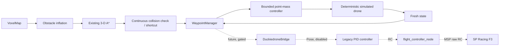

# Duckiedrone integration architecture

This integration preserves `archive/duckiedrone_pidrone_pkg/` as recovered reference code.
All active Python 3.11 code is under `src/ece3162/` and has no mandatory ROS or serial dependency.

Simulation uses metric local `x,y,z` with positive `z` up. Grid indices in the
new 2-D utility are `(row, column)`; columns are local +x and rows local +y,
then the configured map yaw is applied. VoxelMap uses `(x,y,z)` indices and
cell-center metric conversion. These conventions are not asserted to match the
legacy aircraft: recovered state estimators inconsistently label frames
`Body` and `global`, while `flight_controller_node.py` describes its transformed
body axes as x-right, y-forward, z-up. The hardware transform is **UNVERIFIED**.

The mockable bridge represents only the verified absolute-position message
shape. It does not import `rospy`, create a publisher, select a mode, arm,
take off, hold, land, or disarm. Loss of feedback deactivates navigation
publishing. This is deliberately distinct from the legacy flight-controller
failsafe and from disarming.
